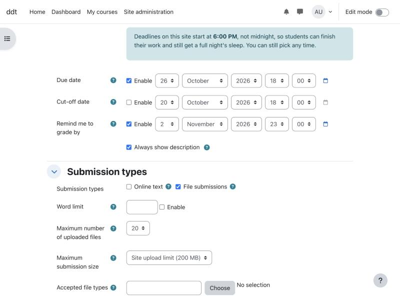

# Default deadline time for Moodle (`local_defaultduetime`)

New Moodle activities start with a deadline of **midnight**. This plugin makes them start at **6:00 PM** instead
(or any time you pick), so the deadline a teacher gets without thinking about it is one that lets students
sleep.

Teachers can still choose any time. Saved activities are never changed.



## What it does

- When a teacher **creates** an assignment, quiz, forum, lesson, choice, feedback, workshop, SCORM package or
  database activity, its deadline fields start at the site's default time.
- A default of "midnight at the start of day 7" becomes "6:00 PM on day 6". The plugin only ever moves a
  default **earlier**, never later.
- Deadlines that start switched off (like a quiz's close date) are pre-filled with 6:00 PM, so when the
  teacher ticks **Enable** they see 6:00 PM instead of the current clock time.
- An optional note above the deadline fields tells teachers why. You can rewrite it.

It does not touch deadlines that are already saved, deadlines a teacher has typed in, or anything in
backup and restore.

## Install

1. Download this repository and put it at `local/defaultduetime` inside your Moodle folder
   (on Moodle 5.1 and later: `public/local/defaultduetime`).
   ```bash
   git clone https://github.com/KalmanG/moodle-local_defaultduetime.git local/defaultduetime
   ```
2. Log in as an admin and go to **Site administration > Notifications** to finish the install.
3. Go to **Site administration > Plugins > Local plugins > Default deadline time** to set the time.

Works with Moodle 4.1 to 5.1.

## Settings

| Setting | Default | What it does |
|---|---|---|
| Set a default deadline time | On | Turns the plugin on or off. |
| Hour / Minute | 18:00 | The default deadline time, in each teacher's own timezone. |
| Deadline fields | see below | Which date fields get the default time, one `module:field` per line. |
| Show a note to teachers | On | Shows a short note above the deadline fields. |
| Note text | (built in) | Your own wording. Markdown works; `{time}` becomes the default time. |

Default deadline fields:

```
assign:duedate
assign:cutoffdate
quiz:timeclose
forum:duedate
forum:cutoffdate
lesson:deadline
choice:timeclose
feedback:timeclose
workshop:submissionend
workshop:assessmentend
scorm:timeclose
data:timeavailableto
```

## No plugin? Assignments only, with one setting

Moodle already lets admins set the default assignment due date as an offset from **midnight today**. Out of
the box it is 7 days, which lands on midnight. Set it to **6 days 18 hours** instead and new assignments are due
at 6:00 PM on day 6.

- In the browser: **Site administration > Plugins > Activity modules > Assignment > Assignment settings >
  Due date**, enter **162 hours** (6 days 18 hours; the box takes one unit at a time).
- Or in `config.php` (locks the value so it can't be changed in the browser):
  ```php
  $CFG->forced_plugin_settings = [
      'assign' => [
          'duedate' => 583200,       // 6 days 18 hours, in seconds: 6:00 PM on day 6.
          'duedate_enabled' => 1,
      ],
  ];
  ```

Two limits:

- It only covers assignments. Quizzes, forums and the other activities have no admin default date.
- The offset is a fixed number of seconds, so when the clocks change during those 6 days the deadline lands an
  hour off (5:00 PM or 7:00 PM). We saw this in testing: an assignment created a week before the UK clock change
  defaulted to 17:00. The plugin sets the time of day directly, so it doesn't drift.

## Why

Late-night deadlines push students to stay up to submit. A 6:00 PM default is a small change that makes the
easy choice the healthy one, without taking any choice away from teachers.

## License

GNU GPL v3 or later, the same as Moodle. Made by the Health Culture Foundation.
